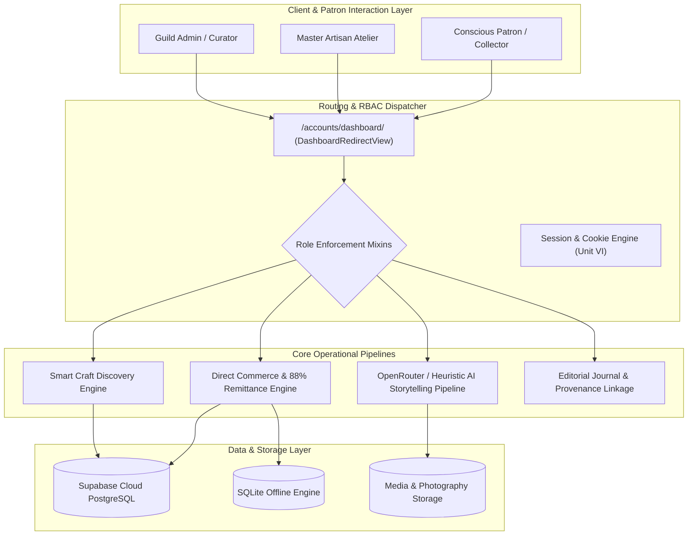
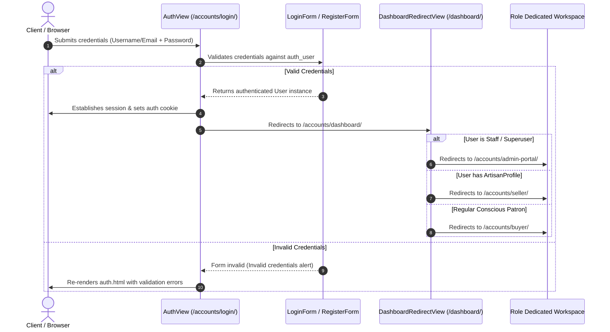
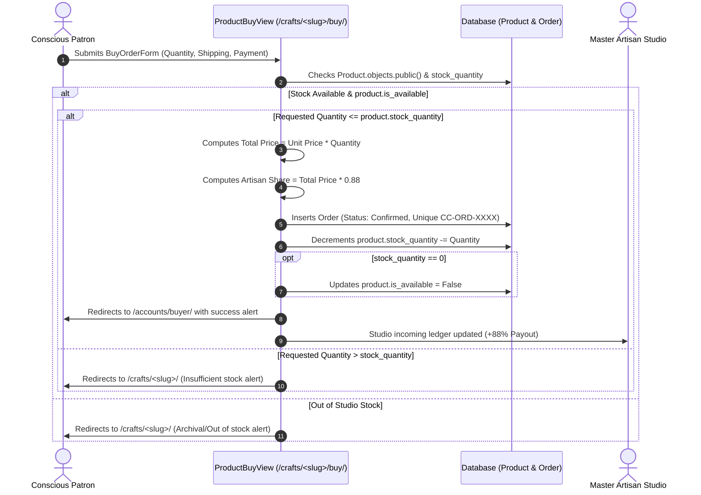
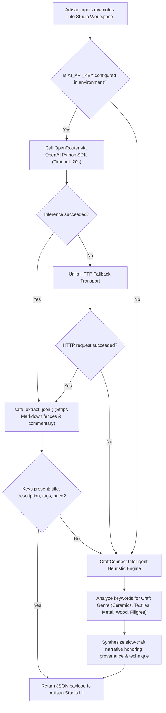
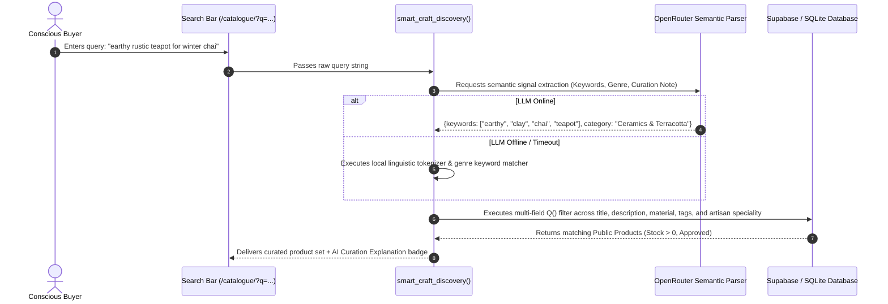
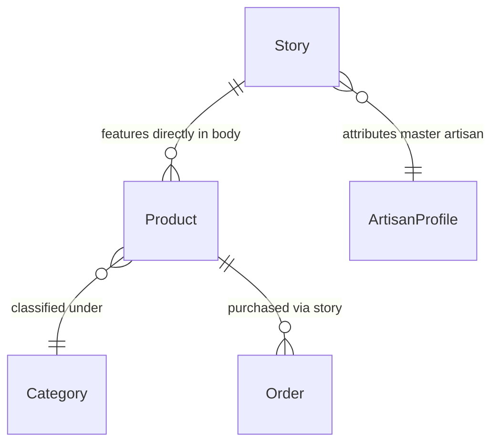
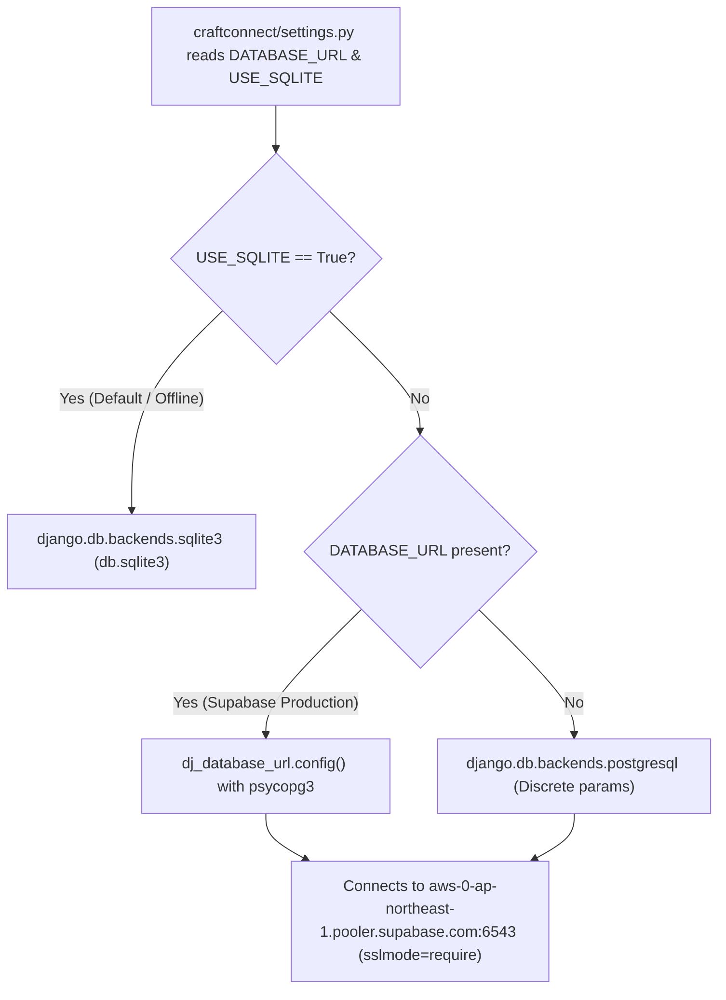
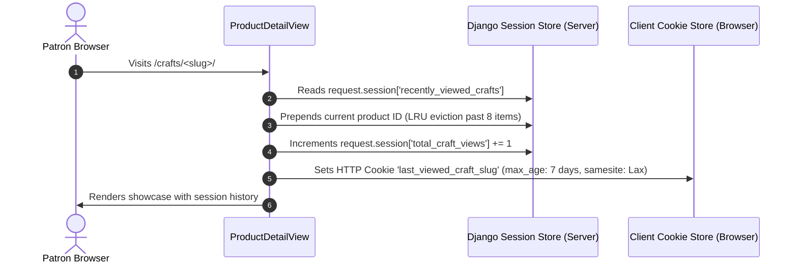

# SkillsCraft AI — End-to-End System Pipelines Specification
## Architecture, Data Flow, AI Inference & Commerce Engine Chronicle

---

### Executive Overview

**SkillsCraft AI** (CraftConnect) is an editorial, slow-craft e-commerce platform engineered to connect rural Indian master artisans directly with conscious patrons worldwide. The platform's architectural foundation is built on robust, deterministic, and modular pipelines covering:

1. **Authentication & Role-Based Access Control (RBAC) Pipeline**
2. **Direct Commerce & 88% Fair-Trade Remittance Pipeline**
3. **Open-Source AI Cataloguing & Storytelling Pipeline**
4. **Smart Craft Discovery & Semantic Search Pipeline**
5. **Editorial Journal & Cultural Provenance Pipeline**
6. **Data Ingestion, Media & Database Seeding Pipeline**
7. **Dual-Engine Database & Infrastructure Pipeline**
8. **Session & Cookie State Telemetry Pipeline (Syllabus Unit VI)**
9. **Quality Assurance & Verification Pipeline**

---



---

## 1. Authentication & Role-Based Access Control (RBAC) Pipeline

### 1.1 Overview
The authentication pipeline provides secure, split-screen onboarding and login supporting both username and `@gmail.com` email address credentials. Logged-in users are dynamically dispatched to role-specific sanctuary workspaces using strict Role-Based Access Control (RBAC).



### 1.2 Access Control Matrix & Guards

| Pipeline Stage | Guard / Mixin | Enforced Precondition | Fallback / Redirection |
| :--- | :--- | :--- | :--- |
| **Patron Sanctuary** (`/accounts/buyer/`) | `BuyerRequiredMixin` | `request.user.is_authenticated` | Redirects to `/accounts/login/` with informative flash message. |
| **Artisan Studio** (`/accounts/seller/`) | `SellerRequiredMixin` | `request.user.is_authenticated` AND `hasattr(user, 'artisan_profile')` | If unauthenticated $\rightarrow$ `/accounts/login/`. If authenticated Buyer $\rightarrow$ `/accounts/become-artisan/`. |
| **Curator Portal** (`/accounts/admin-portal/`) | `AdminRequiredMixin` | `request.user.is_authenticated` AND (`is_staff` OR `is_superuser`) | Rejects non-staff with access denied alert and routes to `/accounts/buyer/`. |
| **Atelier Creation** (`/accounts/become-artisan/`) | `BuyerRequiredMixin` | Authenticated patron upgrading to master artisan | If already has `artisan_profile` $\rightarrow$ routes directly to `/accounts/seller/`. |

---

## 2. Direct Commerce & 88% Fair-Trade Remittance Pipeline

### 2.1 Overview
The direct commerce engine replaces traditional inquiry-only workflows with an authenticated, zero-intermediary direct acquisition pipeline (`/crafts/<slug>/buy/`). It guarantees an untouchable **88% direct artisan allocation**, prevents overselling, and automatically transitions depleted stock into archival status.



### 2.2 Mathematical Model for Financial Remittances

$$\text{Total Price} = P_{\text{unit}} \times Q_{\text{ordered}}$$

$$\text{Direct Artisan Remittance} = \left\lfloor \text{Total Price} \times 0.88 \times 100 + 0.5 \right\rfloor \div 100$$

$$\text{Guild Logistics \& Packaging Reserve} = \text{Total Price} - \text{Direct Artisan Remittance}$$

* **Example 1**: Gorakhpur Terracotta Carafe ($P = ₹1,250$, $Q = 1$):
  * Patron Pays: **₹1,250.00**
  * Direct Artisan Payout (88%): **₹1,100.00**
  * Platform Packing & Freight (12%): **₹150.00**
* **Example 2**: Pure Chanderi Zari Saree ($P = ₹6,800$, $Q = 1$):
  * Patron Pays: **₹6,800.00**
  * Direct Artisan Payout (88%): **₹5,984.00**
  * Platform Packing & Freight (12%): **₹816.00**

---

## 3. Open-Source AI Cataloguing & Storytelling Pipeline

### 3.1 Overview
The AI Cataloguing pipeline synthesizes raw, informal workshop notes into collector-grade editorial titles, heritage provenance descriptions, search tags, and fair-trade pricing recommendations using OpenRouter open-source LLMs (`nvidia/nemotron-3.5-super-vl:free` / Meta Llama 3) with an algorithmic, offline heuristic engine fallback.



### 3.2 Heuristic Fallback Matrix (Zero-Downtime Resilience)

| Detected Craft Domain | Matching Keywords | Generated Category | Suggested Pricing Base | Search Tags Provisioned |
| :--- | :--- | :--- | :---: | :--- |
| **Ceramics & Terracotta** | `clay`, `pottery`, `terracotta`, `kulhad`, `vase`, `earthen` | `Ceramics & Terracotta` | ₹1,450.00 | `wheel-thrown`, `terracotta`, `slow-living`, `lead-free`, `tableware` |
| **Textiles & Handloom** | `silk`, `cotton`, `saree`, `handloom`, `dupatta`, `ajrakh`, `ikat` | `Textiles & Handloom` | ₹3,850.00 | `handloom`, `natural-indigo`, `mulberry-silk`, `sustainable-fashion` |
| **Metalcraft & Dhokra** | `brass`, `bronze`, `metal`, `dhokra`, `bell metal`, `kansa` | `Metalcraft & Dhokra` | ₹2,950.00 | `lost-wax`, `dhokra`, `antique-brass`, `handcrafted-metal`, `patina` |
| **Woodwork & Carving** | `wood`, `teak`, `sheesham`, `carved`, `walnut`, `jali` | `Woodwork & Carving` | ₹2,250.00 | `hand-carved`, `reclaimed-teak`, `slow-craft`, `organic-finish` |
| **Heritage Keepsakes** | `filigree`, `tarakasi`, `silver`, `jewelry`, `pearl`, `art` | `Heritage Keepsakes` | ₹1,800.00 | `handmade`, `fair-trade`, `direct-artisan`, `ethical-luxury` |

---

## 4. Smart Craft Discovery & Semantic Search Pipeline

### 4.1 Overview
The discovery engine processes natural language, emotive buyer prompts (e.g., *"earthy rustic teapot for winter chai"*) by combining LLM-powered query semantic decomposition with multi-field weighted database ranking.



---

## 5. Editorial Journal & Cultural Provenance Pipeline

### 5.1 Overview
The storytelling system bridges slow journalism with authentic artisan provenance. Editorial stories celebrate generational craft wisdom, showcase master craftsmen portraits, and dynamically link featured heirlooms directly within the narrative.



* **Dynamic Editorial Filtering**: Readers filter chronicles across *Ceramics & Terracotta*, *Textiles & Handloom*, *Metalcraft & Dhokra*, and *Woodwork & Carving*.
* **Product-to-Story Linkage**: Many-to-many relationship (`Story.related_products`) enables readers to acquire the exact craft heirlooms described in the article with real-time stock availability badges.

---

## 6. Data Ingestion, Media & Database Seeding Pipeline

### 6.1 Overview
The seeding pipeline (`python manage.py seed_data`) automates the creation of a complete, realistic slow-craft marketplace environment.

```mermaid
flowchart LR
    Start["python manage.py seed_data"] --> Dirs["Step 1: Scaffolds media/ (products, artisans, stories, categories)"]
    Dirs --> Groups["Step 2: Calls setup_groups_and_permissions (Artisans, Patrons, Curators)"]
    Groups --> Accounts["Step 3: Seeds 9 Verified Accounts (Admin, 5 Artisans, 3 Buyers)"]
    Accounts --> Assets["Step 4: Downloads & caches 12 slow-craft high-res photos"]
    Assets --> Products["Step 5: Creates 12 Masterpiece Products linked to Artisans & Categories"]
    Products --> Interactions["Step 6: Seeds Wishlist Bookmarks & Direct Inquiry Threads"]
    Interactions --> Stories["Step 7: Seeds 5 Editorial Journal Stories & links Heirlooms"]
    Stories --> Orders["Step 8: Seeds 7 Historical Orders with verified 88% remittances"]
    Orders --> Complete["Seed Complete — All Systems Verified"]
```



---

## 7. Dual-Engine Database & Infrastructure Pipeline

### 7.1 Overview
The platform incorporates an environment-driven dual-engine database strategy configured in `craftconnect/settings.py`.



### 7.2 Connection Parameters
* **Cloud Database**: Supabase PostgreSQL 15.x
* **Pooling Endpoint**: `aws-0-ap-northeast-1.pooler.supabase.com:6543/postgres`
* **Pool Mode**: Transaction & Session Pooling
* **SSL Protocol**: `sslmode=require`
* **Development Engine**: SQLite 3 with atomic in-memory transactions during testing (`file:memorydb_default`)

---

## 8. Session & Cookie State Telemetry Pipeline (Syllabus Unit VI)

### 8.1 Overview
In compliance with Unit VI requirements, the platform tracks patron engagement using dual-layer state management:



* **Session Telemetry**:
  * `request.session["recently_viewed_crafts"]`: Ordered list of up to 8 unique product IDs.
  * `request.session["total_craft_views"]`: Cumulative counter of craft detail views.
* **Cookie Telemetry**:
  * `response.set_cookie("last_viewed_craft_slug", product.slug, max_age=604800, samesite="Lax")`: Preserves the patron's last examined craft piece across browser restarts for personalized homepage spotlighting.

---

## 9. Quality Assurance & Verification Pipeline

### 9.1 Test Suite Structure
The testing pipeline verifies 207 automated test cases spanning both local apps:

```text
============================================================
 SkillsCraft AI Test Suite Hierarchy
============================================================
├── accounts/tests.py (74 Tests)
│   ├── ArtisanProfileModelTests       (Model fields, __str__, ordering, defaults)
│   ├── LoginFormTests                 (Username, Email, invalid credentials, remember_me)
│   ├── RegisterFormTests              (Buyer/Artisan paths, email normalization, duplicates)
│   ├── BecomeArtisanFormTests         (Validation, required fields)
│   ├── ArtisanProductFormTests        (Positive price, title requirement)
│   ├── RoleBasedAuthenticationTests   (RBAC Mixins, /dashboard/ central routing)
│   ├── AuthViewTests                  (GET tabs, POST login, POST signup, redirects)
│   ├── LogoutViewTests                (GET/POST logout)
│   ├── BuyerDashboardViewTests        (Context dictionary, order counters, impact metrics)
│   ├── ArtisanStudioViewTests         (GET context, POST product creation, inventory)
│   ├── BecomeArtisanViewTests         (GET onboarding, POST creation, already-artisan guard)
│   ├── AIAssistantSuggestViewTests    (JSON endpoint, auth guards, AI response formatting)
│   ├── ModerationPortalViewTests      (Curation queues, approve/reject artisan & products)
│   └── ArtisanDetailViewTests         (Public view, 404 on unapproved profiles)
│
└── marketplace/tests.py (133 Tests)
    ├── MarketplaceRoutingAndFormTests (URL reverse & resolve, search/buy/enquiry forms)
    ├── CategoryModelTests             (Slug generation, uniqueness, __str__)
    ├── ProductModelTests              (Public manager, check constraints, slug collision)
    ├── EnquiryModelTests              (Buyer inquiries, relationships, defaults)
    ├── SavedProductModelTests         (Unique buyer-product constraint, IntegrityError)
    ├── OrderModelTests                (Order tokens, 88% direct remittance calculation)
    ├── StoryModelTests                (Slug generation, M2M related products, defaults)
    ├── HomeViewTests                  (Context, sessions, cookies, featured items)
    ├── ProductCatalogViewTests        (Search query, category filtering, ordering)
    ├── ProductDetailViewTests         (200 for approved, 404 for unapproved, cookies)
    ├── CategoryDetailViewTests        (Category creations, 404 on nonexistent)
    ├── CraftArchiveYearViewTests      (Unit II: Regex /archive/<year>/ matching)
    ├── ProvenanceLookupViewTests      (Unit II: Regex /provenance/CC-<id>/ matching)
    ├── ProductEnquiryViewTests        (Auth required, POST redirect)
    ├── ProductBuyAndOrderTests        (Purchase flow, stock decrement, 88% remittance)
    ├── ToggleSaveProductViewTests     (Add/remove bookmark toggle, auth guard)
    ├── EditorialJournalStoryTests     (Story list, category filter, story detail)
    ├── CraftExtrasTemplateTagTests    (Unit III: inr_format, artisan_initials, badges)
    ├── GroupsAndPermissionsTests      (Unit V: setup_groups_and_permissions command)
    ├── AIServiceTests                 (LLM extraction, heuristic engine fallback)
    └── AdminRegistrationTests         (Admin site model registrations)
```

### 9.2 Verification Commands
To execute and verify all system pipelines locally:

1. **Run Full Automated Test Suite (207 Tests)**:
   ```powershell
   $env:USE_SQLITE="True"; .\.venv\Scripts\python.exe manage.py test accounts marketplace
   ```
2. **Execute Live End-to-End Diagnostic Audit**:
   ```powershell
   $env:USE_SQLITE="True"; .\.venv\Scripts\python.exe manage.py check
   $env:USE_SQLITE="True"; .\.venv\Scripts\python.exe manage.py makemigrations --check
   $env:USE_SQLITE="True"; .\.venv\Scripts\python.exe manage.py verify_ai
   ```
3. **Launch Platform Development Server**:
   ```powershell
   $env:USE_SQLITE="True"; .\.venv\Scripts\python.exe manage.py runserver 127.0.0.1:8000
   ```

---

<div align="center">
  <sub>Documented for SkillsCraft AI • End-to-End Technical Pipelines & Architecture Specification</sub>
</div>

