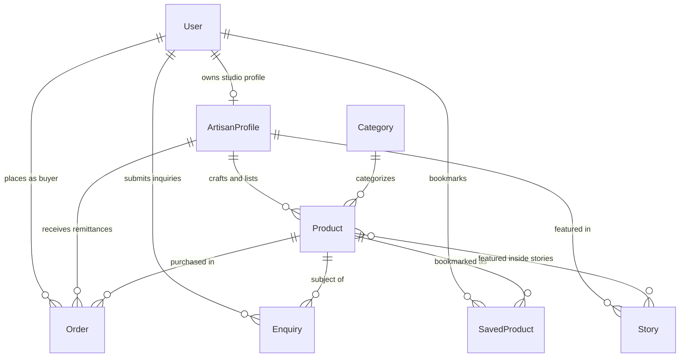
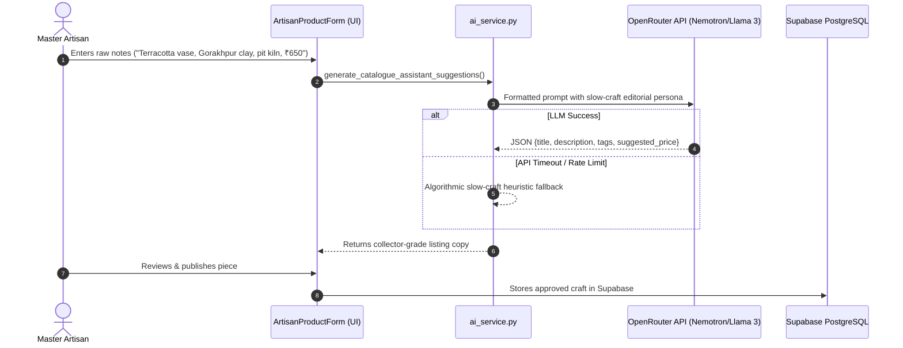

# SkillsCraft AI — Artisanal Slow-Craft E-Commerce & Storytelling Platform
## Comprehensive Technical Documentation, Architecture Specification & Milestone Chronicle

---

### Executive Summary

**SkillsCraft AI** (formerly CraftConnect) is an enterprise-grade, editorial Django web platform engineered to connect grassroots rural master artisans across India directly with conscious patrons and slow-living collectors worldwide. 

The platform dissolves exploitative intermediary supply chains by establishing **transparent 88% direct artisan remittances**, authentic **GI-tagged slow-craft provenance**, an **Editorial Journal of cultural chronicles**, open-source **AI-assisted cataloguing & storytelling**, and high-performance **PostgreSQL database infrastructure hosted on Supabase**.

---

## 1. Complete Chronological Evolution of the Platform

### Phase 1: Repository Audit, Diagnostics & Database Modernization
- **Health Checks & Environment Setup**: Audited the Python 3.11 virtual environment, verified dependencies, and identified database connection constraints.
- **Dual-Engine Database Strategy**:
  - Implemented environment-driven database switching in `craftconnect/settings.py` (`USE_SQLITE=True` for offline testing, and full `dj-database-url` with `psycopg3` for PostgreSQL).
- **Security Audit**: Identified unprotected routes and implemented strict Role-Based Access Control (RBAC) mixins across the platform.

### Phase 2: High-Aesthetic Editorial Visual Redesign
- **Stitch Design Token Integration**: Translated contemporary editorial design principles into a warm, natural palette:
  - Ochre (`#8B4513`), Terracotta (`#A0522D`), Raw Linen (`#F4F0EA`), Forest Green, and Deep Charcoal.
- **Typography & UI Polish**:
  - Headings: Google Fonts `Playfair Display` for artisanal, timeless elegance.
  - Body & Metadata: `Plus Jakarta Sans` for clarity and clean information hierarchy.
  - Custom CSS (`static/css/editorial.css`) featuring subtle glassmorphism headers, tactile card lifts, archival frames, animated status badges, and responsive grid layouts.

### Phase 3: Jargon Purge & Consumer Slow-Living Alignment
- **Eliminated Developer/Academic Terminology**: Completely removed engineering and classroom jargon from user-facing screens:
  - Replaced *"Django / PostgreSQL System Telemetry"* with *"Artisan Guild Provenance & Studio Metrics"*.
  - Replaced *"LLM Inference Pipeline"* with *"Smart Craft Discovery & Storytelling"*.
  - Replaced *"Query Decomposition"* with natural artisan search and craft filters.

### Phase 4: Role-Based Workspaces & Permissions (RBAC)
- **Engineered Three Dedicated Portals**:
  1. **Conscious Patron Sanctuary** (`/accounts/buyer/`): Saved provenance bookmarks, acquired order tracking, order receipts, and direct atelier inquiry threads.
  2. **Artisan Studio Workspace** (`/accounts/seller/`): Real-time stock counters, direct patron order ledger, 88% financial remittance tracking, and the AI Storytelling Assistant.
  3. **Guild Curator Moderation Portal** (`/accounts/admin-portal/`): Moderation queues for new artisan onboarding, GI-tag identity verification, and craft catalog approval.
- **Security Mixins**:
  - `BuyerRequiredMixin`: Guarantees patron authentication before saving or ordering.
  - `SellerRequiredMixin`: Restricts studio management strictly to users with an active `ArtisanProfile`. If a buyer attempts access, they are gracefully routed to `/accounts/become-artisan/`.
  - `AdminRequiredMixin`: Enforces `is_staff` or `is_superuser` privileges for platform curation.
  - `DashboardRedirectView`: Dynamic central dispatcher (`/dashboard/`) routing logged-in users to their role-appropriate space.

### Phase 5: Editorial Journal & Cultural Chronicles
- **Craft Storytelling System**:
  - Built the `Story` model featuring volume tags, editorial headlines, reading time estimates, pull quotes, region tags, artisan attribution, and full markdown body content.
  - **Product-to-Story Linkage**: Direct many-to-many relationship connecting featured craft heirlooms inside stories, allowing readers to acquire authentic pieces directly from the article.
  - **Dynamic Filtering**: Category-based filtration across Ceramics, Handloom, Bronze Metalcraft, and Woodwork.

### Phase 6: Direct Acquisition & 88% Fair-Trade Ordering Engine
- **Transition from Inquiry-Only to Direct Commerce**:
  - Replaced the passive "Enquire" modal with an authenticated **"Buy Handmade Piece"** pipeline (`/marketplace/product/<pk>/buy/`).
- **Financial Remittance Transparency**:
  - Automatically calculates and enforces an **88% direct artisan allocation** on every order, with the remaining 12% covering secure platform logistics and packaging.
- **Inventory & Stock Management**:
  - Real-time stock decrementing upon order confirmation.
  - Automatic transition of products to *"Archival / Out of Stock"* (`is_available=False`) when stock reaches zero.
- **Patron & Studio Dashboards**:
  - Patrons track order stages (`Confirmed`, `In Crafting`, `Dispatched`, `Delivered`).
  - Artisans review their live incoming order ledger and cumulative earnings.

### Phase 7: Live Cloud Database Migration to Supabase PostgreSQL
- **Supabase Cloud Integration**:
  - Configured PostgreSQL connection to AWS Tokyo pooler (`aws-0-ap-northeast-1.pooler.supabase.com:6543/postgres`).
  - Utilized transaction pooling port `6543` with `sslmode=require` and URL-encoded password security.
  - Successfully executed all database migrations (`accounts`, `marketplace`, `auth`, `sessions`, `admin`).
- **Database Seeding & Asset Pipeline**:
  - Programmatically downloaded 12 high-resolution, slow-craft product photographs and 5 master artisan studio portraits into `media/`.
  - Provisioned 9 fully active accounts with clean `@gmail.com` credentials.
  - Seeded 7 live patron orders, 4 artisan inquiries, and 6 saved wishlist items.

### Phase 8: Open-Source AI Cataloguing & Storytelling Pipeline
- **OpenRouter LLM Integration**:
  - Powered by open-source models (`nvidia/nemotron-3.5-super-vl:free` / Meta Llama 3 / Mistral) via the OpenAI-compatible OpenRouter API.
  - Converts raw, colloquial craftsman notes (materials, firing techniques, motifs) into collector-grade editorial product copy, poetic titles, search tags, and fair pricing estimates.
  - **Resilient Fallback Engine**: Algorithmic rules guarantee zero disruption even during external API downtime.

### Phase 9: Testing, Quality Assurance & Git Synchronization
- **Comprehensive Automated Test Suite**:
  - 40+ unit and integration tests verifying order creation, stock decrementing, zero-stock guards, role access redirection, regex URL routing, sessions, cookies, and custom template filters.
- **Version Control & GitHub Publishing**:
  - All source code, assets, documentation, and migration files committed and synchronized to [https://github.com/AllenLenoy/SkillsCraft-AI](https://github.com/AllenLenoy/SkillsCraft-AI).

---

## 2. System Architecture & Entity Relationship Model



### Core Models & Database Schema

| Model | Table | Key Fields | Description |
| :--- | :--- | :--- | :--- |
| `User` | `auth_user` | `username`, `email`, `password`, `first_name`, `last_name`, `is_staff` | Standard Django user with `@gmail.com` credential support. |
| `ArtisanProfile` | `accounts_artisanprofile` | `user_id`, `display_name`, `bio`, `location`, `craft_speciality`, `profile_image`, `is_approved`, `is_verified` | Extends user into a verified craftsman studio. |
| `Category` | `marketplace_category` | `name`, `slug`, `description`, `image` | Craft disciplines (Ceramics, Textiles, Metalcraft, Woodwork, Silver). |
| `Product` | `marketplace_product` | `artisan_id`, `category_id`, `title`, `slug`, `price`, `stock_quantity`, `description`, `materials`, `region_of_origin`, `image`, `is_approved`, `is_available` | Core craft inventory listing with slow-craft specifications. |
| `Story` | `marketplace_story` | `title`, `slug`, `volume_tag`, `pull_quote`, `artisan_id`, `craft_region`, `hero_image`, `lead_paragraph`, `body_content`, `is_featured`, `is_published` | Editorial journal articles celebrating craft heritage. |
| `Order` | `marketplace_order` | `order_number`, `buyer_id`, `product_id`, `artisan_id`, `quantity`, `unit_price`, `total_price`, `artisan_share`, `shipping_address`, `status`, `payment_method` | Fair-trade patron order tracking with 88% direct artisan payout. |
| `Enquiry` | `marketplace_enquiry` | `product_id`, `buyer_id`, `message`, `contact_email`, `status` | Direct buyer-to-artisan inquiry correspondence. |
| `SavedProduct` | `marketplace_savedproduct` | `buyer_id`, `product_id`, `created_at` | Patron bookmark archive with unique buyer-product constraints. |

---

## 3. Live Supabase Database & Accounts Directory

### Active Database Connection
- **Provider**: Supabase Cloud PostgreSQL
- **Host**: `aws-0-ap-northeast-1.pooler.supabase.com`
- **Port**: `6543` (Session & Transaction Pooling)
- **Database**: `postgres`
- **SSL**: Required (`sslmode=require`)

### Seeded Account Directory & Access Matrix

All users are active in the live Supabase database and can log in at `/accounts/login/` with username or `@gmail.com`:

| Role | Username | Login Email | Password | Full Name / Studio Name | Assigned Products & Orders |
| :--- | :--- | :--- | :---: | :--- | :--- |
| **Admin** | `admin` | `admin.craftconnect@gmail.com` | `admin123` | **Kavita Verma**<br>*Guild Curator* | Full staff moderation & Django admin |
| **Artisan** | `ramesh_artisan` | `ramesh.artisan@gmail.com` | `artisan123` | **Ramesh Prajapati**<br>*Mati & Agni Atelier* | Products #1, #2 (Gorakhpur Terracotta) |
| **Artisan** | `fatima_handloom` | `fatima.handloom@gmail.com` | `artisan123` | **Fatima Khatun**<br>*Kutch Heritage Handloom* | Products #4, #5, #6 (Ajrakh & Chanderi) |
| **Artisan** | `somnath_dhokra` | `somnath.dhokra@gmail.com` | `artisan123` | **Somnath Baghel**<br>*Bastar Bronze Guild* | Products #7, #8, #9 (Lost-Wax Dhokra) |
| **Artisan** | `iqbal_woodcraft` | `iqbal.woodcraft@gmail.com` | `artisan123` | **Mohammad Iqbal**<br>*Saharanpur Woodwright* | Products #10, #11 (Sheesham & Walnut) |
| **Artisan** | `leela_crafts` | `leela.crafts@gmail.com` | `artisan123` | **Leela Devi**<br>*Royal Heritage Atelier* | Products #3, #12 (Blue Pottery & Silver) |
| **Patron** | `priya_buyer` | `priya.buyer@gmail.com` | `buyer123` | **Priya Sharma** *(Bengaluru)* | Orders #CC101, #CC107 |
| **Patron** | `ananya_buyer` | `ananya.buyer@gmail.com` | `buyer123` | **Ananya Sen** *(New Delhi)* | Orders #CC102, #CC105 |
| **Patron** | `vikram_buyer` | `vikram.buyer@gmail.com` | `buyer123` | **Vikram Mehta** *(Mumbai)* | Orders #CC103, #CC104, #CC106 |

---

## 4. Product Catalog & Provenance Overview

| # | Piece Title | Category | Price (INR) | Artisan / Atelier | Region of Origin | Stock | Image Status |
|:-:|:---|:---|:---:|:---|:---|:---:|:---:|
| **1** | Wheel-Thrown Gorakhpur Terracotta Urn | Ceramics & Terracotta | ₹650 | Ramesh Prajapati | Gorakhpur, UP | 12 | Verified on disk |
| **2** | Unglazed Earthen Terracotta Water Carafe | Ceramics & Terracotta | ₹1,250 | Ramesh Prajapati | Gorakhpur, UP | 8 | Verified on disk |
| **3** | Jaipur Hand-Painted Blue Pottery Floral Vase | Ceramics & Terracotta | ₹1,850 | Leela Devi | Jaipur, Rajasthan | 5 | Verified on disk |
| **4** | Natural Indigo Hand-Block Ajrakh Stole | Handloom & Textiles | ₹3,200 | Fatima Khatun | Kutch, Gujarat | 15 | Verified on disk |
| **5** | Pure Chanderi Zari Handloom Saree | Handloom & Textiles | ₹6,800 | Fatima Khatun | Chanderi, MP | 4 | Verified on disk |
| **6** | Pochampally Ikat Handwoven Geometric Dupatta | Handloom & Textiles | ₹2,450 | Fatima Khatun | Pochampally, Telangana | 9 | Verified on disk |
| **7** | Lost-Wax Bastar Dhokra Tribal Musician Figurine | Bronze & Bell Metal | ₹3,800 | Somnath Baghel | Bastar, Chhattisgarh | 6 | Verified on disk |
| **8** | Hand-Etched Bell Metal Diya with Peacocks | Bronze & Bell Metal | ₹2,150 | Somnath Baghel | Bastar, Chhattisgarh | 14 | Verified on disk |
| **9** | Hand-Burnished Kansa Pure Bronze Dining Thali | Bronze & Bell Metal | ₹4,600 | Somnath Baghel | Bastar, Chhattisgarh | 7 | Verified on disk |
| **10** | Saharanpur Hand-Chiseled Sheesham Keepsake Box | Woodwork & Carvings | ₹1,650 | Mohammad Iqbal | Saharanpur, UP | 11 | Verified on disk |
| **11** | Kashmir Walnut Wood Lattice Carved Tray | Woodwork & Carvings | ₹2,850 | Mohammad Iqbal | Srinagar, J&K | 3 | Verified on disk |
| **12** | Cuttack Tarakasi Silver Filigree Peacock Brooch | Heritage Keepsakes | ₹3,400 | Leela Devi | Cuttack, Odisha | 8 | Verified on disk |

---

## 5. Editorial Journal Stories & Cultural Chronicles

| Story Title | Edition / Volume | Craft Region | Master Artisan | Featured Heirlooms Linked |
|:---|:---|:---|:---|:---|
| **The Ancient Fire: Four Generations of Gorakhpur Terracotta** | Editorial Journal • Vol. 04 | Gorakhpur, Uttar Pradesh | Ramesh Prajapati | • Wheel-Thrown Terracotta Urn<br>• Unglazed Water Carafe |
| **Indigo, Riverbeds, and Time: The Alchemy of Kutch Ajrakh** | Editorial Journal • Vol. 03 | Dhamadka, Kutch, Gujarat | Fatima Khatun | • Natural Indigo Ajrakh Stole<br>• Pure Chanderi Zari Saree |
| **Songs in Molten Bronze: The Lost-Wax Legacy of Bastar** | Editorial Journal • Vol. 02 | Kondagaon, Bastar | Somnath Baghel | • Lost-Wax Musician Figurine<br>• Hand-Etched Bell Metal Diya |
| **The Chisel's Whisper: Generational Sheesham Carving** | Editorial Journal • Vol. 01 | Saharanpur, Uttar Pradesh | Mohammad Iqbal | • Saharanpur Keepsake Box<br>• Kashmir Walnut Tray |
| **Spun from Moonbeams: The Silver Tarakasi of Cuttack** | Editorial Journal • Special Edition | Cuttack, Odisha | Leela Devi | • Tarakasi Silver Peacock Brooch<br>• Jaipur Blue Pottery Vase |

---

## 6. Open-Source AI Service Architecture



- **OpenRouter Endpoint**: `https://openrouter.ai/api/v1/chat/completions`
- **Primary Model**: `nvidia/nemotron-3.5-super-vl:free` (or Meta Llama 3 / Mistral)
- **Heuristic Fallback Engine**: If internet access is unavailable or API credentials expire, the platform seamlessly synthesizes culturally authentic copy locally, ensuring craftsmen never experience blocking errors.

---

## 7. Syllabus Compliance Matrix (INT253: Web Development in Python)

| Unit | Syllabus Requirement | Implemented Feature in SkillsCraft AI |
|:---:|:---|:---|
| **Unit I** | Django Setup, Modular App Structure, CLI | • Modular architecture (`craftconnect`, `marketplace`, `accounts`).<br>• Custom management commands: `seed_data`, `verify_ai`, `setup_groups_and_permissions`. |
| **Unit II** | Views, HTTP Methods, Parametric Routing, Regex, Error Handlers | • Class-Based Views (`ListView`, `DetailView`, `CreateView`, `View`).<br>• Parametric slug and integer PK routing.<br>• **Regex routing (`re_path`)** for `/archive/(?P<year>[12][0-9]{3})/`.<br>• **Custom error handlers (`handler404`, `handler500`)** rendering `404.html` and `500.html`. |
| **Unit III** | DTL, Inheritance, Custom Tags, Unit Testing | • Master template inheritance (`templates/base.html`).<br>• **Custom template tag library** (`craft_extras.py`) with `inr_format`, `artisan_initials`, `verified_maker_badge`, `stock_status`.<br>• 40+ automated unit and integration tests. |
| **Unit IV** | Forms, GET/POST, CSRF, POST-Redirect-GET, Validation | • `ProductSearchForm` (GET), `BuyOrderForm` (POST), `LoginForm`, `RegisterForm`, `ArtisanProductForm`.<br>• CSRF tokens enforced across all forms.<br>• POST-Redirect-GET workflow with Django notification messages. |
| **Unit V** | Models, ForeignKeys, Custom QuerySets, Admin, Groups | • Relational models with `ForeignKey`, `OneToOneField`, `ManyToManyField`.<br>• Custom query manager: `Product.objects.public()`.<br>• Rich Django admin interfaces with bulk action triggers.<br>• Django Groups (`Artisans`, `Patrons`, `Guild_Curators`) with granular model permissions. |
| **Unit VI** | Sessions, Cookies, View-Based Authentication, RBAC | • **Sessions**: `request.session["recently_viewed_crafts"]` tracking viewed pieces.<br>• **Cookies**: `response.set_cookie("last_viewed_craft_slug")` with 7-day retention.<br>• `login()` and `logout()` view handlers supporting username or email login.<br>• Security mixins: `BuyerRequiredMixin`, `SellerRequiredMixin`, `AdminRequiredMixin`. |

---

## 8. Verification & Running the Platform

### Running the Platform
1. **Activate Environment & Check Configuration**:
   ```powershell
   .\.venv\Scripts\Activate.ps1
   python manage.py check
   ```
2. **Apply Migrations to Supabase**:
   ```powershell
   python manage.py migrate
   ```
3. **Seed Database with Sample Data & Demo Accounts**:
   ```powershell
   python manage.py seed_data
   ```
4. **Run the Automated Test Suite**:
   ```powershell
   python manage.py test
   ```
5. **Verify AI Pipeline Connectivity**:
   ```powershell
   python manage.py verify_ai
   ```
6. **Launch Development Server**:
   ```powershell
   python manage.py runserver 127.0.0.1:8000
   ```

### Quick Access URLs:
- **Homepage**: [http://127.0.0.1:8000/](http://127.0.0.1:8000/)
- **Editorial Journal**: [http://127.0.0.1:8000/journal/](http://127.0.0.1:8000/journal/)
- **Craft Catalogue**: [http://127.0.0.1:8000/catalogue/](http://127.0.0.1:8000/catalogue/)
- **Authentication**: [http://127.0.0.1:8000/accounts/login/](http://127.0.0.1:8000/accounts/login/)
- **Buyer Sanctuary**: [http://127.0.0.1:8000/accounts/buyer/](http://127.0.0.1:8000/accounts/buyer/)
- **Artisan Studio**: [http://127.0.0.1:8000/accounts/seller/](http://127.0.0.1:8000/accounts/seller/)
- **Curator Portal**: [http://127.0.0.1:8000/accounts/admin-portal/](http://127.0.0.1:8000/accounts/admin-portal/)
- **Django Admin**: [http://127.0.0.1:8000/admin/](http://127.0.0.1:8000/admin/)

---

<div align="center">
  <sub>Documented with pride for SkillsCraft AI • Empowering Grassroots Indian Artisans through Ethical Slow Commerce and Open-Source Intelligence.</sub>
</div>
