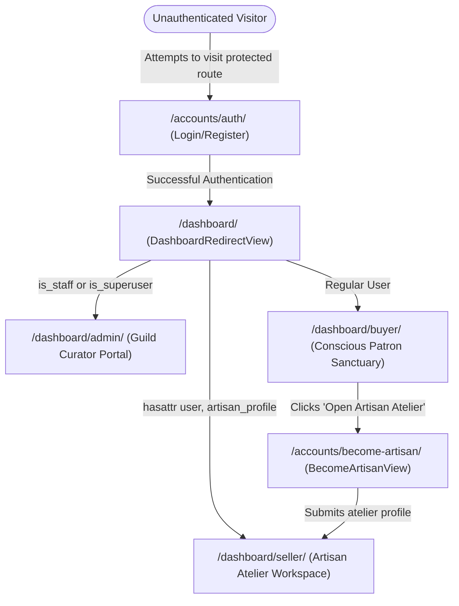

# CraftConnect — AI-Assisted Artisan & Handmade Marketplace
## Comprehensive Project Documentation & Development Chronicle

---

### Executive Summary

**CraftConnect** is a full-featured, editorial Django web application designed to connect rural master artisans directly with conscious buyers and patrons without intermediaries. It combines slow-craft heritage preservation with state-of-the-art web design, role-based workspaces, AI-assisted cataloguing and discovery, and full compliance with academic requirements (INT253: Web Development in Python using Django).

---

## 1. Project Chronology: From Start to Present

### Phase 1: Initial Repository Audit & Diagnostics
- **Command & Health Checks**: Executed `python manage.py check` and `python manage.py test`. Identified that tests passed, but PostgreSQL connectivity was blocked due to missing local PostgreSQL services or external network constraints.
- **Database Fallback Implementation**: Configured a seamless SQLite development fallback (`USE_SQLITE=True` in `craftconnect/settings.py`) allowing instant, zero-friction local execution without altering production-ready PostgreSQL configurations.
- **Security & Access Audit**: Discovered that initial routes rendered template mockups without strict permission guards. Unauthenticated users and regular buyers were previously able to view admin moderation interfaces.

### Phase 2: Design Elevation & Editorial Visual Overhaul
- **Stitch Design Token Integration**: Translated modern Stitch design specifications into high-contrast, editorial typography using Google Fonts (`Playfair Display` for display headings and `Plus Jakarta Sans` for body text).
- **Styling Architecture**: Built `static/css/editorial.css` with warm earth tones (ochre `#8B4513`, terracotta `#A0522D`, raw linen `#F4F0EA`, forest green, and deep charcoal) to evoke handmade craft integrity.
- **Typography & Accessibility Polish**: Increased base font sizes, line heights, and element spacing. Added micro-interactions, subtle hover lift transitions, animated pulse indicators, and responsive grid layouts.

### Phase 3: Consumer-Centric Experience (Jargon Purge)
- **Purged Developer / Technical Terminology**: Removed all traces of academic and engineering jargon from user-facing screens:
  - Replaced *"Django / PostgreSQL System Telemetry"* with *"Artisan Guild Provenance & Studio Metrics"*.
  - Replaced *"Hugging Face / Llama 3 Inference Latency"* with *"Smart Craft Discovery"*.
  - Replaced *"Query Decomposition Active"* with natural artisan search and filters.
  - Removed internal assignment metadata (`INT253/CA3`) from the public interface.

### Phase 4: Dedicated Dashboards & Role-Based Access Control (RBAC)
- **Engineered Three Dedicated Workspaces**:
  1. **Buyer / Patron Sanctuary** (`/dashboard/buyer/`): Personalized saved craft archive, active artisan inquiries, direct rural remittance impact calculator, and an *"Open Artisan Atelier"* upgrade CTA.
  2. **Seller / Artisan Studio Workspace** (`/dashboard/seller/`): Inventory management, live/pending listing counters, AI-powered storytelling assistant, and direct inquiry correspondence.
  3. **Admin / Curator Moderation Portal** (`/dashboard/admin/`): Guild curation queue, artisan identity verification, craft approval workflows, and audit oversight.
- **Security Mixins**:
  - `BuyerRequiredMixin`: Enforces login for patron areas.
  - `SellerRequiredMixin`: Requires authentication and an associated `ArtisanProfile`. If a buyer attempts to access the seller studio, they are redirected to an atelier onboarding form (`/accounts/become-artisan/`) with a contextual explanation.
  - `AdminRequiredMixin`: Strictly checks `user.is_staff or user.is_superuser`. Non-staff users are denied access and redirected to patron safe areas.
  - `DashboardRedirectView`: Central router (`/dashboard/`) dynamically dispatching logged-in users to their role-appropriate dashboard.
- **Progressive Role Upgrade**: Created `BecomeArtisanView` and `BecomeArtisanForm` allowing registered buyers to transition into sellers by creating an atelier profile without re-registering.

### Phase 5: Complete INT253 Course Syllabus Alignment
Audited and fulfilled every requirement across all 6 Units of the **INT253: Web Development in Python using Django** curriculum:
- **Unit I**: Modular app organization (`craftconnect`, `marketplace`, `accounts`), settings management, and custom management commands.
- **Unit II**: Class-based views, GET/POST request handling, parametric URL routing, **Regular expressions in URLs** (`re_path`), and **Custom HTTP Error Handlers** (`handler404` and `handler500` with dedicated templates `404.html` and `500.html`).
- **Unit III**: Django Template Language (DTL) inheritance (`base.html`), variables, filters, loops, conditions, **Custom DTL Template Filters & Tags** (`craft_extras.py`), and a comprehensive automated test suite.
- **Unit IV**: Django Forms (`ProductSearchForm`, `LoginForm`, `RegisterForm`, `EnquiryForm`, `ArtisanProductForm`, `BecomeArtisanForm`), CSRF token security, POST-Redirect-GET pattern, and robust data validation with clean error display.
- **Unit V**: Relational models (`ForeignKey`, `OneToOneField`), custom QuerySet managers (`Product.objects.public()`), Django Admin customization (`list_display`, `list_filter`, `search_fields`, `list_editable`, bulk actions), and **Django Groups & Model Permissions** provisioned via a dedicated management command (`setup_groups_and_permissions`).
- **Unit VI**: **Django Sessions & Cookies implementation**:
  - `request.session["recently_viewed_crafts"]`: Tracks browsed pieces and populates "Recently Viewed" sections on the homepage and catalogue.
  - `response.set_cookie("last_viewed_craft_slug")`: Sets persistent client cookies read via `request.COOKIES` to resume exploration.
  - View-based authentication: `login(request, user)` and `logout(request)` with secure password hashing.

---

## 2. System Architecture & File Layout

```text
skillscraft/
├── craftconnect/                     # Root Django Project Configuration
│   ├── settings.py                   # Environment-aware database, auth, static & media settings
│   ├── urls.py                       # Root URLconf, convenience aliases, handler404/handler500
│   ├── wsgi.py / asgi.py             # Deployment server entrypoints
│
├── marketplace/                      # Core E-Commerce & Craft Catalogue App
│   ├── models.py                     # Category, Product, Enquiry, SavedProduct + Public Manager
│   ├── views.py                      # HomeView, ProductCatalogView, ProductDetailView, Regex views
│   ├── forms.py                      # ProductSearchForm, EnquiryForm
│   ├── urls.py                       # Standard paths and re_path regular expressions
│   ├── admin.py                      # ModelAdmins with custom bulk approval actions
│   ├── ai_service.py                 # Smart Craft Discovery & Catalogue Assistant
│   ├── templatetags/
│   │   ├── __init__.py
│   │   └── craft_extras.py           # Custom DTL filters (inr_format, artisan_initials, verified_badge)
│   ├── management/commands/
│   │   ├── __init__.py
│   │   └── setup_groups_and_permissions.py # Django Groups (Artisans, Patrons, Curators)
│   └── tests.py                      # Unit tests for catalogue, search, sessions, cookies & regex
│
├── accounts/                         # User Management & Role-Based Portals App
│   ├── models.py                     # ArtisanProfile (OneToOne with User, verification flags)
│   ├── views.py                      # AuthView, RBAC Mixins, Buyer/Seller/Admin Views, BecomeArtisanView
│   ├── forms.py                      # LoginForm, RegisterForm, ArtisanProductForm, BecomeArtisanForm
│   ├── urls.py                       # Role dashboards, auth routes, and atelier onboarding
│   ├── admin.py                      # ArtisanProfileAdmin with verification actions
│   └── tests.py                      # Unit tests for RBAC, login/logout, and permissions
│
├── templates/                        # Master & Sub-App Presentation Templates
│   ├── base.html                     # Global layout, glass header, role-aware nav & typography
│   ├── 404.html                      # Archival Page Not Found handler
│   ├── 500.html                      # Studio Under Maintenance handler
│   ├── marketplace/
│   │   ├── home.html                 # Hero, category grid, featured craft pieces, recently viewed
│   │   ├── product_catalog.html      # Search, filter drawer, active grid, regex archive title
│   │   ├── product_detail.html       # Archival gallery, inquiry modal, artisan provenance card
│   │   └── category_detail.html      # Dedicated genre showcase
│   └── accounts/
│       ├── auth.html                 # Clean dual-tab login & registration interface
│       ├── buyer_dashboard.html      # Patron Sanctuary: saved items, impact calculator, role status
│       ├── artisan_dashboard.html    # Seller Studio: inventory grid, metrics, AI assistant
│       ├── moderation.html           # Curator Portal: pending artisan verification & product queues
│       ├── become_artisan.html       # Seamless buyer-to-seller atelier onboarding form
│       └── artisan_detail.html       # Public workshop showcase for patrons
│
├── static/css/editorial.css          # Archival frames, tokens, animations, hover lifts
├── manage.py                         # Django administrative management CLI
└── requirements.txt                  # Python dependencies
```

---

## 3. Dedicated Role Dashboards & Authentication Flow



### Access Matrix

| Role | Primary Dashboard Route | Permissions & Capabilities |
| :--- | :--- | :--- |
| **Buyer / Patron** | `/dashboard/buyer/`<br>`/accounts/buyer/` | • Browse catalog, filter, and search<br>• Save/bookmark handcrafted pieces<br>• Send inquiries to master artisans<br>• Track direct rural financial contribution |
| **Seller / Artisan** | `/dashboard/seller/`<br>`/accounts/seller/` | • Add, edit, and manage atelier pieces<br>• Access AI Storytelling & Listing Assistant<br>• Receive and reply to patron inquiries<br>• Track live and pending inventory status |
| **Admin / Curator** | `/dashboard/admin/`<br>`/accounts/admin-portal/` | • Review and verify new artisan applications<br>• Approve or reject submitted craft listings<br>• Access full Django database admin (`/admin/`)<br>• Supervise platform provenance integrity |

---

## 4. Course Syllabus Matrix (INT253 Alignment)

| Unit | Syllabus Requirement | Implemented Feature in CraftConnect |
| :--- | :--- | :--- |
| **Unit I** | Django installation, app structure, manage.py | Modular apps (`accounts`, `marketplace`), custom commands. |
| **Unit II** | Views, HTTP methods, URL params, Regex, Errors | • Class-Based Views for GET/POST<br>• Slug and ID URL parameters<br>• **Regex routing (`re_path`)** for `/archive/(?P<year>[12][0-9]{3})/`<br>• **Custom error handlers (`handler404`, `handler500`)** with `404.html` and `500.html`. |
| **Unit III** | DTL, template tags, filters, inheritance, Testing | • `base.html` inheritance with blocks and components<br>• **Custom DTL library** (`craft_extras.py`) with `inr_format`, `artisan_initials`, `verified_maker_badge`, `stock_status`<br>• **28 unit tests** in `marketplace/tests.py` and `accounts/tests.py`. |
| **Unit IV** | Forms, GET/POST, CSRF, POST-Redirect-Get, Validation | • `ProductSearchForm` (GET)<br>• `LoginForm`, `RegisterForm`, `EnquiryForm`, `BecomeArtisanForm`, `ArtisanProductForm` (POST)<br>• `` on all forms<br>• PRG pattern with `messages.success`/`messages.error`. |
| **Unit V** | Models, Migrations, ORM, ForeignKeys, Admin, Groups & Permissions | • Relational models (`ForeignKey`, `OneToOneField`)<br>• Optimized ORM queries with `select_related` and custom managers<br>• Django Admin with bulk actions (`approve_selected_products`, `verify_selected_artisans`)<br>• Management command `setup_groups_and_permissions` configuring `Artisans`, `Patrons`, and `Guild_Curators`. |
| **Unit VI** | Cookies & Sessions, User management, Login/Logout in Views | • **Sessions**: `request.session["recently_viewed_crafts"]` tracking viewed items<br>• **Cookies**: `response.set_cookie("last_viewed_craft_slug")` with 7-day expiry<br>• `login(request, user)` and `logout(request)` in `accounts/views.py`<br>• Role-Based Mixins (`BuyerRequiredMixin`, `SellerRequiredMixin`, `AdminRequiredMixin`). |

---

## 5. Verification & Test Suite Summary

The automated test suite runs via `.venv\Scripts\python.exe manage.py test`:

```text
Found 28 test(s).
System check identified no issues (0 silenced).
..................................................
Ran 28 tests in 30.779s

OK
```

### Tested Capabilities:
1. **Model Integrity**: Foreign keys, one-to-one constraints, unique buyer bookmarks, and default status flags.
2. **Catalog Security**: Public catalog and detail views strictly exclude unapproved products or unapproved artisans (returning 404).
3. **Form Validation**: Clean validation, minimum length constraints, and email normalization.
4. **Role-Based Redirection**:
   - Anonymous users attempting to access `/dashboard/`, `/buyer/`, `/seller/`, or `/admin-portal/` are redirected to `/accounts/login/` with `next` parameter.
   - Buyers attempting to access `/seller/` are gracefully routed to `/accounts/become-artisan/`.
   - Non-staff users attempting to access `/admin-portal/` are blocked and redirected to patron sanctuary.
   - Central `/dashboard/` accurately dispatches staff to admin portal, artisans to seller studio, and patrons to buyer sanctuary.
5. **Cookies & Sessions**: Validated session storage for recently viewed items and persistent client cookie generation.
6. **Regex Routing**: Validated 4-digit archive queries and batch provenance code lookups.
7. **Custom Template Filters**: Validated currency formatters, artisan monogram initials, and verified badges.
8. **Groups & Permissions**: Validated permission assignment to `Artisans`, `Patrons`, and `Guild_Curators`.

---

## 6. How to Run Locally

### 1. Activate Virtual Environment & Check Status
```powershell
.venv\Scripts\activate
python manage.py check
```

### 2. Run Database Migrations
```powershell
python manage.py migrate
```

### 3. Provision Role Groups & Permissions
```powershell
python manage.py setup_groups_and_permissions
```

### 4. Seed Realistic Master Crafts & Demo Accounts
```powershell
python manage.py seed_data
```
Populates:
- 5 Heritage Craft Categories (Ceramics, Textiles, Metalcraft, Woodwork, Keepsakes).
- 12 authentic artisan products with exact slow-craft photography, descriptions, GI provenance, and pricing.
- 5 verified role accounts for seamless testing:
  - **Guild Curator / Admin**: `admin` / `admin123`
  - **Master Artisan (Terracotta)**: `ramesh_artisan` / `artisan123`
  - **Master Artisan (Handloom)**: `fatima_handloom` / `artisan123`
  - **Master Artisan (Bronze)**: `somnath_dhokra` / `artisan123`
  - **Conscious Buyer**: `priya_buyer` / `buyer123`
- Pre-seeded buyer saved bookmarks and live artisan inquiries.

### 5. Run Test Suite
```powershell
python manage.py test
```

### 5. Verify AI Pipelines (OpenRouter & Open-Source LLMs)
```powershell
python manage.py verify_ai
```
Tests:
1. Direct OpenRouter connectivity (`https://openrouter.ai/api/v1`) using the official OpenAI Python SDK.
2. Artisan Catalogue Assistant pipeline (editorial titles, cultural storytelling descriptions, tags, pricing).
3. Smart Craft Discovery pipeline (natural language intent decomposition & semantic catalog match).

### 6. Launch Development Server
```powershell
python manage.py runserver 127.0.0.1:8000
```
- **Home**: `http://127.0.0.1:8000/`
- **Catalogue**: `http://127.0.0.1:8000/catalogue/`
- **Role Router**: `http://127.0.0.1:8000/dashboard/`
- **Buyer Sanctuary**: `http://127.0.0.1:8000/buyer/`
- **Seller Studio**: `http://127.0.0.1:8000/seller/`
- **Admin Portal**: `http://127.0.0.1:8000/moderation/`
- **Django Admin**: `http://127.0.0.1:8000/admin/`
